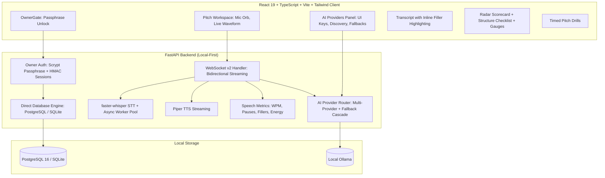

# 🚀 AI Pitch Coach (SOTA Edition)

<div align="center">

[](https://fastapi.tiangolo.com)
[](https://react.dev)
[](https://www.typescriptlang.org)
[](https://tailwindcss.com)
[](https://www.docker.com)
[](LICENSE)

**A real-time, voice-first AI startup pitch coaching platform with multi-AI provider orchestration, local-first owner security, and 6-dimensional SOTA scoring.**

[Features](#-key-features) • [Quick Start](#-quick-start) • [Architecture](#-architecture) • [Coaching Modes](#-coaching-modes) • [AI Providers](#-bring-your-own-ai) • [Docker](#-docker-deployment)

</div>

---

## 🌟 Key Features

- **🎙️ Real-time Voice Pipeline:** Stream raw microphone audio over WebSockets with sub-second speech transcription via `faster-whisper` and natural voice synthesis with `Piper TTS`.
- **🧠 Bring-Your-Own-AI (Inspired by Muse):** Input API keys directly in the UI for **OpenAI, Anthropic Claude, Google Gemini, Groq, DeepSeek, Mistral, OpenRouter, and local Ollama**. Automatically discover models and benchmark roundtrip latency with live tests.
- **🛡️ Local-First Owner Gate:** Secure local authentication using **scrypt passphrase hashing**, one-time server setup codes, and signed HMAC session tokens. **Zero dependency on cloud auth or external services**.
- **📊 6-Dimensional Radar Scorecard:** Evaluates pitches across **Clarity, Structure, Persuasion, Delivery, Confidence, and Relevance** with a real-time animated radar chart.
- **📋 Pitch Structure Checklist:** Live automated detection of essential pitch components: **Hook, Problem, Solution, Market, Traction, and Ask**.
- **🗣️ Speech Delivery & Rhythm Metrics:** Live computation of words-per-minute (WPM), pause frequency, strategic pause ratio, and **inline filler-word highlighting** (e.g., *um, uh, like, basically, you know*).
- **⏱️ Timed Pitch Drills:** Built-in interactive timers for 60s Elevator Pitches, 3-minute Seed Pitches, and 5-minute Demo Day presentations.
- **🔄 Turn Regeneration & History:** Rename sessions, edit previous pitch turns, and delete sessions with custom confirm dialogs.
- **🐳 100% Dockerized:** One command (`docker compose up --build`) runs the entire stack with PostgreSQL, the FastAPI backend, and the compiled React frontend.

---

## 📐 Architecture



---

## 🎯 Coaching Modes

| Mode | Purpose | Scorecard | Default TTS |
|------|---------|:---------:|:-----------:|
| **Pitch Analysis** | Full assessment with 6D radar scorecard, structure checklist, and ranked fixes | ✅ Yes | ❌ No |
| **Interactive Coaching** | Conversational turn-by-turn coaching with one high-impact tip per turn | ❌ No | ✅ Yes |
| **Investor Q&A** | Probes problem/solution fit, unit economics, market size, and defensibility | ✅ Yes | ✅ Yes |
| **Delivery & Vocal Coaching** | Focuses on speaking cadence, pauses, vocal confidence, and filler reduction | ✅ Yes | ✅ Yes |
| **Objection Handling** | Prepares speakers for investor skepticism and aggressive pushback | ❌ No | ✅ Yes |
| **Pitch Polish & Rewrite** | Rewrites your pitch to lead with urgency, pain points, and memorable metrics | ❌ No | ❌ No |
| **Market & Competitor Intel** | Contextualizes your pitch against market benchmarks and competitor dynamics | ❌ No | ❌ No |
| **Freeform Conversation** | Warm-up sparring partner for general speaking practice and communication confidence | ❌ No | ✅ Yes |

---

## 🚀 Quick Start

### Option 1: Docker (Recommended)

Run the complete self-contained stack with PostgreSQL:

```bash
docker compose up --build
```

Open **`http://localhost:8000`** in your browser. On your first run, check your terminal for the generated **Setup Code** (e.g. `QP4E-42FN`) to set your owner passphrase.

---

### Option 2: Standalone Local Setup

#### 1. Requirements
- Python 3.10+
- Node.js 18+
- A modern browser with microphone access

#### 2. Install Backend Dependencies
```bash
python -m venv .venv
source .venv/bin/activate  # On Windows: .venv\Scripts\activate
pip install -r requirements.txt
```

#### 3. Build the Frontend
```bash
cd web
npm install
npm run build
cd ..
```

#### 4. Launch the App
```bash
uvicorn backend.main:app --port 8000 --reload
```

Open **`http://localhost:8000`**. On first launch, the terminal will print:
```text
#################################################################
  FIRST-RUN SETUP CODE (CLAIM YOUR LOCAL PITCH COACH):
  >>>  QP4E-42FN  <<<
  Enter this code in your browser to set your owner passphrase.
#################################################################
```

---

## 🧠 Bring-Your-Own-AI

Click the **Settings** gear icon in the sidebar to open the **AI Providers Panel**:

1. **Add Provider:** Choose from **OpenAI, Anthropic Claude, Google Gemini, Groq, DeepSeek, Mistral, OpenRouter, or Ollama**.
2. **Enter API Key:** Masked and securely encrypted in local storage with AES-256-GCM.
3. **Fetch Models:** One click queries the provider's `/v1/models` endpoint and populates available models.
4. **Test Latency:** Click **Test** to measure response time and verify connectivity in real-time.
5. **Fallback Cascade:** Configure an automated fallback order so your coaching session never fails if an API experiences rate limits.

---

## 🧪 Running Automated Tests

Run the full pytest suite:

```bash
make test
# Or directly:
pytest tests/ -v
```

All 10 unit tests cover:
- Owner authentication & setup code security
- Session persistence & cascade deletion
- 6-dimensional scorecard parsing & fallback regex extraction
- Filler word and phrase detection
- REST API lifecycle endpoints

---

## 📜 License

MIT License. Designed and built for startup founders, speakers, and innovators worldwide.
